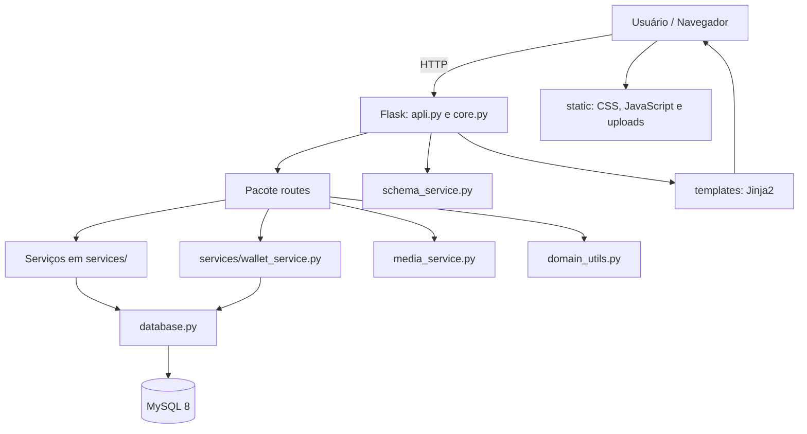
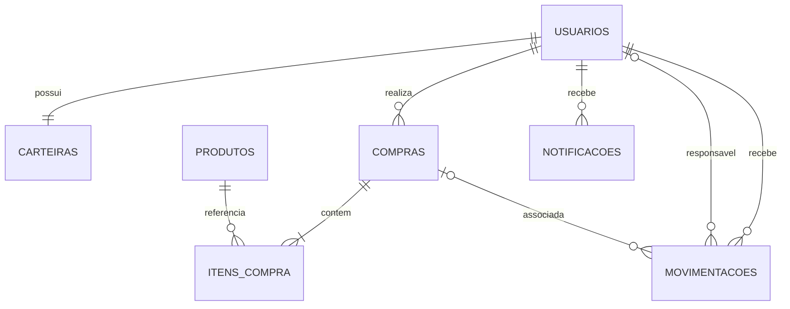
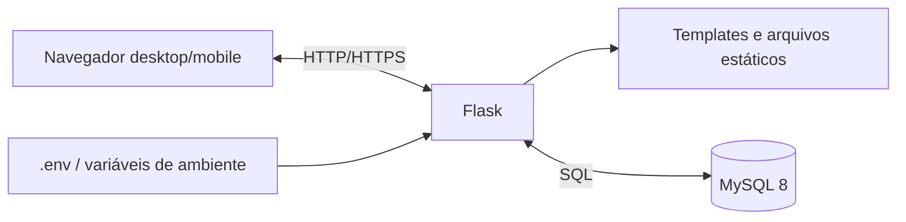

# Arquitetura do Confia+

## 1. Visão geral

O Confia+ é uma aplicação web monolítica modular desenvolvida em Python, Flask e MySQL 8. O navegador acessa a aplicação Flask; as rotas recebem as requisições, aplicam as verificações de acesso e coordenam serviços e operações no banco. Os arquivos de interface são renderizados com Jinja2, enquanto CSS, JavaScript, imagens e uploads ficam em `static/`.

A organização em módulos separa responsabilidades dentro de uma única aplicação. O projeto **não é composto por microsserviços** e não possui uma pasta `migrations/` nesta versão.



## 2. Tecnologias e inicialização

- **Python:** linguagem principal do backend.
- **Flask:** aplicação web e gerenciamento das requisições.
- **Jinja2:** renderização dos templates HTML.
- **MySQL Server 8:** persistência dos dados.
- **mysql-connector-python:** conexão entre Python e MySQL.
- **HTML, CSS, Bootstrap e JavaScript:** interface do navegador.
- **Pillow:** validação e processamento de imagens.
- **python-dotenv:** carregamento das configurações locais do arquivo `.env`.

O ponto de entrada é `apli.py`. Ele importa os módulos do pacote `routes`, registrando seus endpoints no aplicativo Flask. Quando executado diretamente, inicializa o banco por meio de `initialize_database()` e inicia o servidor Flask de desenvolvimento.

`core.py` cria e configura a instância Flask, carrega configurações e reúne autenticação, autorização, sessão e funções compartilhadas utilizadas pelas rotas. Também importa serviços transversais, como carteira e mídia.

`database.py` implementa a camada de acesso ao MySQL e adapta consultas/operações para a interface utilizada pelo restante do projeto.

## 3. Organização real dos módulos

| Caminho | Responsabilidade |
|---|---|
| `apli.py` | Ponto de entrada; importa as rotas, inicializa o esquema e inicia o servidor Flask em execução direta. |
| `core.py` | Instância e configuração Flask, sessão, autenticação, autorização, helpers e funções compartilhadas. |
| `database.py` | Conexão MySQL, consultas, comandos e controle de transações. |
| `schema_service.py` | Definição e criação inicial das tabelas MySQL. |
| `services/wallet_service.py` | Consulta de saldo e registro de movimentações financeiras. |
| `media_service.py` | Validação, processamento e armazenamento de imagens de perfil e produtos. |
| `domain_utils.py` | Funções auxiliares de domínio, validação, formatação e normalização. |
| `routes/auth.py` | Login, primeiro acesso e fluxos de autenticação/cadastro inicial. |
| `routes/profile.py` | Perfil do usuário, dados cadastrais, senha, PIN, foto, notificações e página de ajuda. |
| `routes/shopping.py` | Catálogo, carrinho, checkout e histórico de compras do cliente. |
| `routes/operations.py` | Operações de produtos, estoque e recargas. |
| `routes/admin.py` | Administração de usuários, relatórios e auditoria. |

| `services/checkout_service.py` | Regras e processamento transacional das compras. |
| `services/product_service.py` | Validação e operações especializadas de produtos. |
| `services/report_service.py` | Consultas e preparação dos dados de relatórios. |
| `services/topup_service.py` | Registro e processamento de recargas. |
| `scripts/seed.py` | Carga opcional de contas, carteiras e produtos fictícios para demonstração. |
| `scripts/backup.py` | Exportação do banco e dos uploads. |
| `scripts/restaurar_backup.py` | Restauração do banco e dos uploads a partir de um backup. |
| `templates/` | Páginas HTML renderizadas pelo Jinja2. |
| `static/css/app.css` | Folha de estilos consolidada da aplicação. |
| `static/js/app.js` | Interações gerais e comportamentos compartilhados da interface. |
| `static/js/price-suggestion.js` | Cálculo e aplicação da sugestão de preço de venda (custo + 50%). |
| `static/js/purchase-confirmation.js` | Comportamento da confirmação visual de compra concluída. |
| `static/js/table-sort.js` | Ordenação das tabelas por coluna. |
| `static/js/topup-customer-search.js` | Busca incremental e seleção de clientes na recarga. |
| `static/` | Imagens e arquivos enviados (uploads). |
| `tests/` | Testes automatizados de serviços e funções auxiliares. |
| `docs/` | Documentação do projeto, incluindo este arquivo. |

## 4. Perfis e autorização

O sistema trabalha com três perfis de acesso:

- **Cliente:** utiliza catálogo, carrinho, carteira, compras, histórico e recursos do próprio perfil.
- **Operador:** executa atividades operacionais, como gerenciamento de produtos/estoque e recargas, conforme as permissões implementadas.
- **Administrador:** acessa funções administrativas, usuários, relatórios e registros de auditoria.

As verificações de autenticação e perfil são feitas no backend. A interface pode ocultar opções que não pertencem ao perfil, mas a restrição efetiva depende das verificações realizadas pelas rotas.

## 5. Persistência e modelo de dados

O esquema definido em `schema_service.py` contém nove tabelas, criadas com `CREATE TABLE IF NOT EXISTS`:

| Tabela | Finalidade |
|---|---|
| `usuarios` | Dados cadastrais, username/e-mail, perfil, estado da conta e hashes de senha/PIN. |
| `carteiras` | Saldo atual de cada usuário; há uma carteira por usuário. |
| `produtos` | Catálogo, descrição, preço de custo e venda, estoque, limite de estoque baixo, estado e foto. |
| `compras` | Cabeçalho da compra, cliente, total, valor pago e data. |
| `itens_compra` | Produtos, quantidades e preços registrados em cada compra. |
| `movimentacoes` | Compras e recargas, com valores e responsáveis. |
| `notificacoes` | Mensagens destinadas aos usuários e estado persistente de leitura. |
| `login_attempts` | Contador persistente de tentativas de autenticação por conta/janela de tempo. |
| `logs_auditoria` | Registro de ações relevantes, responsável, alvo, detalhes e data. |

Relacionamentos conceituais principais:



O diagrama é conceitual e resume as relações de negócio; a definição efetiva de colunas, índices e chaves está no código de `schema_service.py`.

Nesta versão, não existe diretório `migrations/`. A estrutura inicial é criada por `initialize_database()` em `schema_service.py`, importado pelo núcleo da aplicação. `CREATE TABLE IF NOT EXISTS` evita recriar tabelas já existentes, mas não equivale a um mecanismo completo de migração de alterações em tabelas já criadas.

## 6. Fluxos de negócio

### 6.1 Autenticação

1. O usuário informa suas credenciais na tela de login.
2. O backend localiza a conta e valida a senha usando o hash armazenado.
3. A sessão identifica o usuário autenticado.
4. As rotas verificam o perfil e as permissões para cada operação.
5. Os fluxos de primeiro acesso e alteração de credenciais são tratados pelas rotas correspondentes.

Senhas e PINs são armazenados como hashes; o sistema não precisa guardar o texto original para validá-los.

### 6.2 Compra

1. O cliente seleciona produtos e quantidades no catálogo/carrinho.
2. O sistema apresenta o resumo e o total da compra.
3. O cliente informa o PIN para confirmar a operação.
4. O backend valida as credenciais e verifica novamente as condições da compra, incluindo disponibilidade de estoque.
5. O serviço de checkout registra a compra, os itens, a movimentação e a atualização do estoque/carteira dentro do fluxo transacional implementado.

A carteira pode assumir saldo negativo conforme a regra de negócio implementada. A primeira compra que projeta saldo negativo exige confirmação. Depois disso, enquanto o saldo atual permanecer negativo, cada nova compra também exige confirmação. O registro de ciência em `logs_auditoria` é gravado apenas uma vez por cliente; a exigência de confirmação é recalculada pelo saldo atual. O saldo é mantido em `carteiras`; o histórico das operações financeiras é registrado em `movimentacoes`. Recargas são processadas pelos serviços operacionais e refletem no saldo da carteira.

### 6.3 Recarga

A recarga é registrada por um operador e atualiza a carteira do cliente, com registro correspondente no histórico de movimentações.

### 6.4 Produtos e estoque

As rotas operacionais utilizam o serviço de produtos para validar e processar informações do catálogo. Os produtos possuem preço de custo, preço de venda, estoque, limite de estoque baixo e estado ativo. O catálogo do cliente apresenta os produtos conforme os filtros e condições definidos nas rotas.

## 7. Carga de demonstração (`scripts/seed.py`)

O `scripts/seed.py` é opcional e destinado a testes/apresentações locais. Ele define **8 contas** (1 administrador, 2 operadores e 5 clientes), suas carteiras e **10 produtos** fictícios.

Credenciais iniciais das contas criadas pelo seed:

| Perfil | Usuário | Senha inicial | PIN de compra |
|---|---|---|---|
| Administrador | `admin` | `Admin@12345` | Não se aplica |
| Operador | `operador1` | `Operador@12345` | Não se aplica |
| Operador | `operador2` | `Operador@12345` | Não se aplica |
| Cliente | `cliente1` | `Cliente@12345` | `1234` |
| Cliente | `cliente2` | `Cliente@12345` | `2345` |
| Cliente | `cliente3` | `Cliente@12345` | `3456` |
| Cliente | `cliente4` | `Cliente@12345` | `4567` |
| Cliente | `cliente5` | `Cliente@12345` | `5678` |

Os cinco clientes recebem saldo inicial de R$ 20,00 quando a conta/carteira é criada; administrador e operadores recebem carteira com saldo zero. O seed insere dez produtos de exemplo, com preço e estoque iniciais definidos em `scripts/seed.py`.

O script identifica usuários por username ou e-mail e produtos pelo nome (sem diferenciar maiúsculas de minúsculas). Registros existentes não são recriados. Senhas, PINs já preenchidos, dados cadastrais já preenchidos e saldos existentes são preservados. Para clientes de demonstração já encontrados, o script pode completar alguns campos cadastrais vazios e preencher o PIN somente se ainda não houver hash. Se uma conta não tiver carteira, ela é criada com o saldo definido no seed. Produtos existentes não têm preço, estoque ou descrição atualizados. O script não apaga compras nem movimentações.

As credenciais são públicas e devem ser utilizadas somente em ambientes locais de demonstração.

## 8. Integridade e segurança

O projeto utiliza, entre outros mecanismos presentes no código:

- MySQL com InnoDB, chaves e restrições relacionais definidas no esquema;
- hashes para senhas e PINs;
- verificações de autenticação e perfil no backend;
- proteção CSRF nos formulários aplicáveis;
- transações em operações que alteram dados relacionados;
- registros de auditoria para ações relevantes;
- variáveis de ambiente para configurações e credenciais;
- scripts de backup e restauração.

Esses mecanismos não substituem uma revisão de segurança antes de utilizar dados reais ou disponibilizar o sistema publicamente.

## 9. Relatórios, notificações e auditoria

A aplicação possui rotas e telas para relatórios, notificações e consulta de logs de auditoria. O acesso a esses recursos é condicionado ao perfil e às verificações realizadas no backend. Os dados de auditoria são persistidos em `logs_auditoria`; as notificações são armazenadas em `notificacoes`. No painel do cliente, o resumo de notificações é compartilhado entre desktop e mobile. Ao selecionar uma notificação, o backend registra sua leitura; o contador considera apenas as notificações ainda não lidas e permanece atualizado após recarregar a página.

## 10. Testes e limites

Os testes automatizados ficam em `tests/` e cobrem serviços e funções selecionados. Para executá-los, utilize o ambiente virtual com as dependências instaladas:

```bash
python -m pytest -q
```

A presença de testes automatizados não comprova, por si só, todos os fluxos integrados com MySQL, navegador, diferentes perfis ou dispositivos móveis. Antes de uma apresentação ou implantação, execute os principais fluxos no ambiente que será utilizado.

## 11. Implantação simplificada



Em desenvolvimento, a aplicação pode ser iniciada localmente com `python apli.py`. O servidor de desenvolvimento do Flask não deve ser exposto diretamente à internet. Para produção, o README descreve uma implantação de referência com servidor WSGI, Nginx, HTTPS, chave secreta privada, credenciais próprias e rotina de backup.


## 12. Comentários e documentação do código

Os módulos Python utilizam docstrings para registrar a responsabilidade de módulos, classes e funções. Os arquivos JavaScript, CSS e templates Jinja2 possuem comentários de identificação e comentários pontuais nos fluxos de interface. A documentação deve explicar decisões e regras de negócio, sem repetir literalmente cada instrução do código.

Ao alterar uma funcionalidade, atualize também a seção correspondente deste documento, o `MANUAL_DO_USUARIO.md` quando houver impacto para o usuário e o `README.md` quando houver impacto na instalação, execução ou manutenção.


## 13. Organização dos arquivos

- `services/`: serviços e regras reutilizáveis de domínio, incluindo `services/wallet_service.py`.
- `scripts/`: rotinas administrativas executadas manualmente, como backup, restauração e carga de demonstração.
- Raiz do projeto: ponto de entrada (`apli.py`), infraestrutura compartilhada (`core.py`, `database.py`) e inicialização do esquema (`schema_service.py`).

Os scripts em `scripts/` calculam a raiz do projeto a partir do próprio caminho. Assim, podem ser executados a partir da raiz com `python scripts/nome_do_script.py`, sem depender da pasta atual do terminal.
