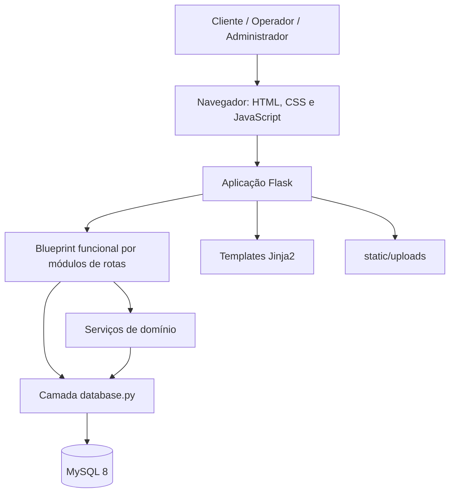
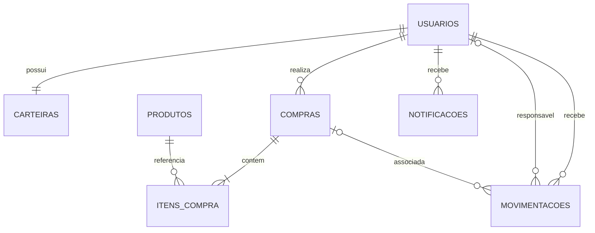

# Arquitetura do Sistema — Confia+

## 1. Escopo e estado

O Confia+ é uma aplicação web Flask para apoiar a operação da Cantina da Honestidade. A arquitetura desta documentação foi conferida com os módulos presentes nesta versão do repositório.

**Estado:** código preparado para execução local e homologação. O ponto de entrada `apli.py` executa o servidor de desenvolvimento Flask com `debug=True`; isso não constitui uma implantação de produção.

## 2. Visão geral



A aplicação utiliza renderização de páginas no servidor com Jinja2 e endpoints HTTP para operações e chamadas assíncronas pontuais. O navegador apresenta a interface; as regras relevantes são verificadas no backend.

## 3. Tecnologias e dependências

| Camada | Tecnologia | Responsabilidade |
|---|---|---|
| Backend web | Python + Flask 3.x | Ciclo HTTP, sessão, filtros, validação e registro de rotas |
| Templates | Jinja2 | Renderização das páginas HTML |
| Frontend | HTML, CSS, JavaScript e Bootstrap nos templates | Layout responsivo, formulários, menus, modais e interações |
| Banco | MySQL 8 + InnoDB | Persistência relacional e transações |
| Driver | mysql-connector-python | Comunicação com MySQL |
| Configuração | python-dotenv | Carregamento das variáveis do `.env` |
| Imagens | Pillow | Processamento de imagens enviadas |
| Testes | unittest | Testes automatizados de serviços e utilitários |

Dependências declaradas em `requirements.txt`: Flask, Pillow, tzdata, mysql-connector-python e python-dotenv.

## 4. Organização do código

```text
apli.py
core.py
database.py
schema_service.py
domain_utils.py
routes/
  auth.py
  shopping.py
  operations.py
  profile.py
  admin.py
services/
  checkout_service.py
  login_attempt_service.py
  media_service.py
  product_service.py
  report_service.py
  topup_service.py
  wallet_service.py
templates/
static/
  css/
  js/
  uploads/
scripts/
  seed.py
  backup.py
  restaurar_backup.py
tests/
docs/
```

### 4.1 Ponto de entrada e núcleo

- `apli.py`: importa a aplicação, inicializa o banco e registra os módulos de rotas.
- `core.py`: cria a instância Flask, configura sessão, CSRF, filtros Jinja, helpers, autenticação e inicialização do esquema.
- `database.py`: abre conexões MySQL por requisição, adapta cursores e oferece `query()` e `execute()`.
- `schema_service.py`: cria as tabelas e executa verificações/migrações pontuais compatíveis com a estrutura existente.
- `domain_utils.py`: reúne formatações e funções auxiliares de domínio.

### 4.2 Módulos de rotas

| Módulo | Responsabilidade |
|---|---|
| `routes/auth.py` | Login, logout, cadastro e primeiro acesso |
| `routes/shopping.py` | Catálogo, QR, carrinho, checkout e histórico |
| `routes/operations.py` | Produtos e recargas |
| `routes/profile.py` | Perfil, notificações e atalhos de ajuda |
| `routes/admin.py` | Gestão de usuários, clientes, relatórios e auditoria |

O endpoint `/operador/clientes` e `/admin/usuarios` compartilham a função de gestão, com comportamento condicionado ao perfil. O operador recebe a tela de clientes; o administrador recebe a tela de contas da equipe.

### 4.3 Serviços

| Serviço | Responsabilidade |
|---|---|
| `checkout_service.py` | Confirmação transacional de compra, validação de estoque, carteira, idempotência e ciência de saldo negativo |
| `wallet_service.py` | Consulta e movimentações da carteira |
| `topup_service.py` | Registro de recarga em dinheiro e prevenção de processamento duplicado |
| `product_service.py` | Validação e interpretação do formulário de produto |
| `report_service.py` | Montagem de dados para relatórios |
| `login_attempt_service.py` | Controle de tentativas e bloqueio temporário de autenticação |
| `media_service.py` | Migração de fotos antigas e processamento/armazenamento de imagens |

## 5. Modelo de dados

O esquema inicial define nove tabelas:

| Tabela | Conteúdo |
|---|---|
| `usuarios` | Dados pessoais, matrícula, e-mail, CPF, username, hashes de senha/PIN, perfil, status e primeiro acesso |
| `carteiras` | Saldo de cada usuário |
| `produtos` | Nome, descrição, categoria, preço, estoque, limite de estoque baixo, status e foto |
| `compras` | Cabeçalho da compra, cliente, total, valor pago, data e chave de idempotência |
| `itens_compra` | Itens, quantidades, nome/preço/custo registrados na compra |
| `movimentacoes` | Compras e recargas, valor, responsável, status, motivo e data |
| `notificacoes` | Mensagens por usuário e estado de leitura |
| `login_attempts` | Tentativas de login por chave de conta e janela temporal |
| `logs_auditoria` | Responsável, ação, alvo, detalhes e data |

### 5.1 Relacionamentos principais



As chaves estrangeiras e índices estão definidos em `schema_service.py`. O diagrama representa os relacionamentos conceituais mais relevantes.

### 5.2 Inicialização e evolução do esquema

`initialize_database()` utiliza `CREATE TABLE IF NOT EXISTS` e verificações pontuais de colunas, como `categoria` e `estoque_baixo`. Isso preserva tabelas existentes e permite algumas atualizações compatíveis, mas **não é um sistema completo de migrações versionadas**. Mudanças futuras de estrutura devem ser planejadas e testadas com backup prévio.

## 6. Fluxos centrais

### 6.1 Autenticação e autorização

1. O usuário envia credenciais.
2. O backend consulta a conta e verifica o hash da senha.
3. O estado da conta e o controle de tentativas são considerados.
4. A sessão guarda a identidade autenticada.
5. Decoradores de autenticação e perfil restringem as rotas.

Perfis existentes: `cliente`, `operador` e `admin`.

### 6.2 Compra

1. O cliente seleciona produtos e quantidades.
2. O carrinho apresenta o total.
3. O cliente informa o PIN.
4. O serviço valida novamente produto ativo, quantidade e estoque.
5. A carteira é atualizada e a compra, itens e movimentação são persistidos no fluxo transacional.
6. A chave de idempotência evita processar novamente a mesma solicitação identificada pela chave.

A carteira permite saldo negativo. O serviço exige ciência quando o saldo atual é zero/positivo e o saldo projetado fica negativo. Enquanto o saldo permanecer negativo, a condição não é repetida em compras adicionais. Se uma recarga levar o saldo para zero ou acima, uma compra posterior que o torne negativo volta a exigir ciência. O evento de ciência é registrado em `logs_auditoria`.

### 6.3 Recarga

O serviço `topup_service.py` registra a operação como `recarga`, com descrição **Recarga em dinheiro**, responsável operador e chave de idempotência. O código não representa integração com Pix, cartão ou banco.

### 6.4 Produtos e categorias

O catálogo usa as categorias `Salgadinhos`, `Biscoitos e Bolinhos`, `Doces e Balas` e `Bebidas`. Os produtos possuem preço de compra, preço de venda, estoque e limite de estoque baixo. O formulário sugere preço de venda com acréscimo de 50% sobre o custo; o preço pode ser conferido/ajustado pelo usuário autorizado.

### 6.5 QR Code

O fluxo QR identifica o produto e oferece sua inclusão no carrinho. A finalização continua dependendo do fluxo normal de checkout e validação de PIN.

## 7. Segurança implementada

- Hash de senhas e PINs usando funções do Werkzeug.
- Sessão Flask com duração configurada de 30 minutos.
- Cookies `HttpOnly` e `SameSite=Lax`; `Secure` é ativado quando `APP_ENV=production`.
- Proteção CSRF em requisições que alteram estado, por token em formulário/header/JSON.
- Controle de tentativas de login persistido em `login_attempts`.
- Verificação de perfil no backend, não apenas ocultação de elementos na interface.
- Limite de tamanho de requisição configurado em 5 MB.
- Validação de destino interno para redirecionamentos.
- Registros de auditoria para ações relevantes.
- Consultas parametrizadas pelo adaptador de banco.

### 7.1 Configuração de segredo

Em desenvolvimento, se `CANTINA_SECRET_KEY` estiver ausente, o código usa uma chave fixa de desenvolvimento e emite aviso. Em `APP_ENV=production`, o processo exige uma chave privada de pelo menos 32 caracteres e interrompe a inicialização se ela não estiver configurada adequadamente.

A chave de desenvolvimento nunca deve ser usada em produção.

## 8. Arquivos e imagens

Fotos de produtos e perfis são processadas pelo `services/media_service.py` e armazenadas em `static/uploads`. O caminho público de uploads permanece dentro da raiz do projeto, mesmo com o serviço localizado em `services/`.

O backup inclui os arquivos de `static/uploads`, além do dump do MySQL.

## 9. Execução e configuração

1. Instalar dependências com `python -m pip install -r requirements.txt`.
2. Criar o banco MySQL `cantina_honestidade` com `utf8mb4`.
3. Copiar `.env.example` para `.env` e configurar host, porta, banco, usuário e senha.
4. Iniciar com `python apli.py`.
5. Acessar `http://127.0.0.1:5000`.

O servidor iniciado por `apli.py` usa `debug=True`, porta 5000 e host `0.0.0.0`. Essa configuração é exclusiva para desenvolvimento/homologação e não deve ser exposta diretamente à internet.

## 10. Seed, testes e backup

### Seed

`python scripts/seed.py` carrega contas e produtos fictícios. O script foi escrito para preservar senhas e saldos já existentes e completar campos cadastrais vazios de contas de demonstração. Não execute o seed em produção sem revisar o conteúdo e o impacto esperado.

### Testes

`python -m unittest discover -s tests -v`

A suíte contém testes unitários para checkout, utilitários, tentativas de login, produtos, relatórios e recargas. A suíte não comprova, por si só, funcionamento integral em produção, integração com todos os cenários reais ou compatibilidade visual em todos os dispositivos.

### Backup e restauração

- `scripts/backup.py`: requer `mysqldump` no PATH; salva dump SQL, ZIP de uploads e manifesto SHA-256.
- `scripts/restaurar_backup.py`: requer `mysql` no PATH; verifica hashes e solicita digitar `RESTAURAR`. A restauração substitui o banco configurado e extrai os uploads.

Realizar backup antes de alterações estruturais e testar a restauração em ambiente isolado.

## 11. Implantação: estado atual e recomendação

### Estado atual

- Aplicação executável localmente pelo servidor de desenvolvimento Flask.
- Banco MySQL 8.
- Configuração por `.env`.
- Arquivos enviados armazenados localmente em `static/uploads`.

### Arquitetura recomendada para produção (ainda depende de implantação e homologação)

- Linux institucional.
- Servidor WSGI de produção (por exemplo, Gunicorn).
- Nginx ou proxy reverso equivalente.
- HTTPS com certificado válido.
- MySQL em rede privada, com usuário dedicado e privilégios mínimos.
- `APP_ENV=production` e chave secreta forte.
- Cookies seguros, backups automatizados e testes de restauração.
- Monitoramento, rotação/retenção de logs, permissões de arquivos e processo de atualização controlado.

Esses itens são recomendações técnicas, não evidência de que a implantação já foi realizada.

## 12. Limitações e pontos de atenção

- Não há integração de pagamento bancário/Pix implementada no fluxo de recarga.
- Não há evidência de implantação institucional ou homologação de produção nesta versão.
- `CREATE TABLE IF NOT EXISTS` e verificações pontuais não substituem migrações versionadas.
- Os testes automatizados cobrem partes selecionadas do domínio; são necessários testes integrados e de aceitação.
- A operação física de recebimento do dinheiro e conferência de estoque continua sendo responsabilidade da equipe.
- Não se deve afirmar redução comprovada de perdas sem estudo com dados comparáveis antes/depois.
