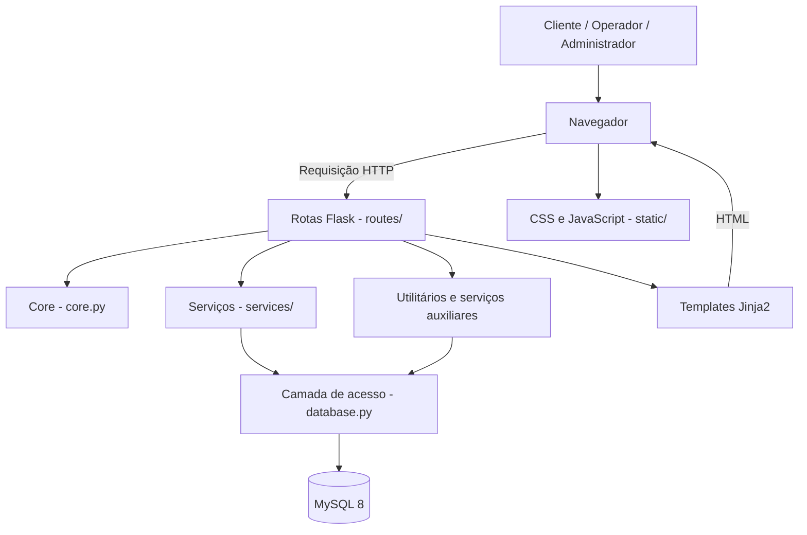
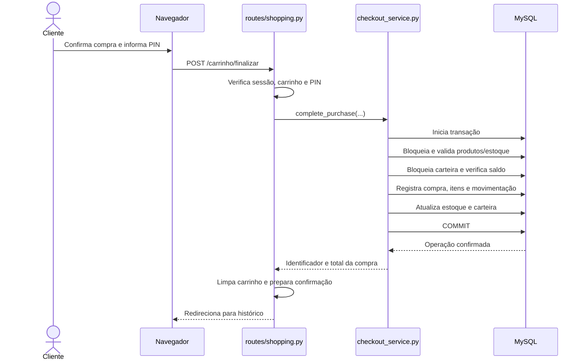
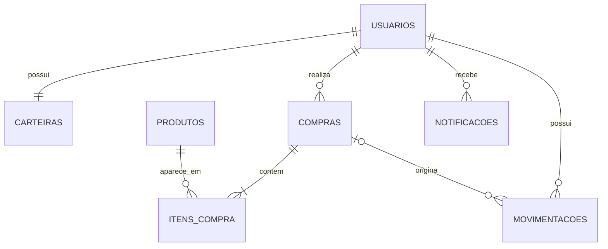

# Documentação técnica do Confia+

## 1. Visão geral

O Confia+ é uma aplicação web monolítica modular desenvolvida em Python, Flask e MySQL 8. O sistema organiza as funcionalidades da cantina em módulos: autenticação, perfis, catálogo, carrinho, compras, carteiras, recargas, produtos, relatórios, notificações e auditoria.

A aplicação é monolítica porque é executada como uma aplicação Flask integrada. A separação em pastas e módulos representa uma divisão interna de responsabilidades; não significa que cada módulo seja um serviço independente ou um microsserviço.

### 1.1 Tecnologias e seus papéis

| Tecnologia | Papel no sistema |
|---|---|
| Python | Implementa o backend, as regras de negócio e a integração com o banco. |
| Flask | Recebe requisições HTTP, executa rotas e coordena respostas. |
| Jinja2 | Renderiza páginas HTML no servidor com os dados recebidos das rotas. |
| MySQL 8 | Armazena usuários, produtos, carteiras, compras e demais registros. |
| MySQL Connector/Python | Faz a comunicação entre o código Python e o MySQL. |
| HTML | Estrutura o conteúdo das páginas. |
| CSS / Bootstrap | Define apresentação visual e responsividade. |
| JavaScript | Implementa interações no navegador, como atualização de carrinho e comportamentos de interface. |
| Pillow | Apoia a validação e o processamento de imagens. |
| python-dotenv | Carrega configurações locais definidas no arquivo `.env`. |

## 2. Arquitetura em camadas

A organização pode ser entendida por responsabilidades:



**Interface:** páginas HTML/Jinja, CSS e JavaScript. É a parte com a qual a pessoa interage.

**Rotas (controllers):** recebem requisições, identificam o contexto do usuário, verificam permissões e dados de entrada, chamam serviços ou consultas e escolhem a resposta.

**Serviços (services):** concentram operações de negócio que precisam ser organizadas e, quando aplicável, reutilizadas. Um serviço não é uma página e não recebe diretamente o clique do navegador.

**Acesso a dados:** `database.py` encapsula a conexão com MySQL e oferece métodos para executar comandos, consultar resultados, confirmar e desfazer transações.

**Persistência:** o MySQL mantém os dados entre acessos e reinicializações da aplicação.

Essa divisão não é absoluta: algumas rotas ainda executam consultas ou regras simples diretamente. A arquitetura é modular, mas não está completamente separada em camadas puras.

## 3. Inicialização e módulos principais

### 3.1 Caminho de inicialização

1. O comando `python apli.py` executa o ponto de entrada.
2. `apli.py` importa a aplicação e os módulos de rotas.
3. `core.py` fornece a instância Flask, configurações, sessão, autenticação, autorização e funções compartilhadas.
4. A inicialização chama a rotina de preparação do esquema do banco.
5. O Flask passa a receber as requisições.

### 3.2 Responsabilidade dos arquivos

| Arquivo ou pasta | Responsabilidade |
|---|---|
| `apli.py` | Ponto de entrada; importa as rotas e inicia a aplicação. |
| `core.py` | Configura Flask, sessão, autenticação, autorização, helpers e recursos compartilhados. |
| `database.py` | Conexão com MySQL, consultas, comandos e controle de transações. |
| `schema_service.py` | Criação e preparação inicial das tabelas. |
| `domain_utils.py` | Funções auxiliares de domínio, validação, normalização e formatação. |
| `media_service.py` | Validação, processamento e armazenamento de imagens. |
| `routes/auth.py` | Login, primeiro acesso e cadastro inicial. |
| `routes/profile.py` | Perfil, credenciais, foto e funcionalidades associadas ao perfil. |
| `routes/shopping.py` | Catálogo, carrinho, inclusão por QR Code, finalização e histórico de compras. |
| `routes/operations.py` | Operações de produtos, estoque e recargas. |
| `routes/admin.py` | Administração, usuários, relatórios e auditoria. |
| `services/checkout_service.py` | Processamento transacional da compra. |
| `services/product_service.py` | Operações especializadas e validações de produtos. |
| `services/topup_service.py` | Processamento de recargas. |
| `services/wallet_service.py` | Consulta de saldo e operações relacionadas à carteira. |
| `services/report_service.py` | Consultas e preparação de informações para relatórios. |
| `services/login_attempt_service.py` | Controle persistente de tentativas de autenticação. |
| `scripts/` | Scripts operacionais de seed, backup e restauração. |
| `templates/` | Templates HTML renderizados pelo Jinja2. |
| `static/` | CSS, JavaScript, imagens e uploads. |
| `tests/` | Testes automatizados de serviços e funções selecionadas. |
| `docs/` | Documentação técnica e operacional. |

## 4. Rotas e serviços: diferença de responsabilidade

Uma rota e um serviço podem participar da mesma funcionalidade, mas não fazem o mesmo trabalho.

### 4.1 Rotas

Uma rota é associada a um endereço HTTP, como `/carrinho/finalizar`. Ela recebe a requisição do navegador, lê os dados enviados, verifica a sessão e as permissões, executa validações próprias da requisição e chama a operação responsável pela regra de negócio.

No Confia+, as rotas de compras estão em `routes/shopping.py`. Esse arquivo também administra o carrinho mantido na sessão do Flask, apresenta o catálogo e o histórico e responde às operações do carrinho.

### 4.2 Serviços

Um serviço concentra uma operação de negócio. Ele pode receber dados já identificados pela rota e executar as validações e alterações necessárias, sem precisar renderizar uma página ou conhecer os detalhes visuais da interface.

No fluxo de compra, `services/checkout_service.py` contém a função `complete_purchase()`. Ela recebe uma conexão com o banco, os dados do usuário, os itens do carrinho, uma chave de idempotência e a confirmação de ciência do saldo negativo quando aplicável.

### 4.3 Como `shopping.py` e `checkout_service.py` trabalham juntos

Nesta versão do código, `routes/shopping.py` importa e chama `complete_purchase()` de `services/checkout_service.py`. Portanto, não são duas implementações independentes da finalização: a rota coordena a requisição e o serviço executa o processamento transacional.

Responsabilidades observadas no código:

| `routes/shopping.py` | `services/checkout_service.py` |
|---|---|
| Mantém e consulta o carrinho na sessão. | Recebe os itens e processa a compra. |
| Exibe catálogo, carrinho e histórico. | Consulta e bloqueia registros relevantes do banco. |
| Valida o formato do PIN e confere seu hash. | Revalida produto, estado e estoque no momento da compra. |
| Verifica a chave de idempotência recebida no formulário. | Registra a compra usando a chave de idempotência. |
| Chama `complete_purchase()`. | Aplica a regra de saldo negativo e registra a ciência quando necessária. |
| Trata exceções e decide a resposta/redirect. | Atualiza estoque, itens, carteira e movimentação. |
| Limpa o carrinho e prepara a confirmação após sucesso. | Confirma a transação ou executa rollback em caso de erro. |



Se uma validação do serviço falhar, a exceção retorna para a rota. A rota decide como informar o cliente, por exemplo, exibindo aviso de estoque insuficiente ou solicitando a confirmação de ciência do saldo negativo.

## 5. Fluxo técnico de uma compra

### 5.1 Preparação do carrinho

O carrinho é mantido na sessão do Flask, usando identificadores de produtos e quantidades. A função `cart_items()` consulta os produtos e calcula subtotais e total para exibição.

O carrinho é uma preparação da compra, não é ainda um registro financeiro definitivo no banco. Por isso, os dados precisam ser validados novamente na finalização: estoque, preço e disponibilidade podem mudar entre a inclusão no carrinho e a confirmação.

### 5.2 Validação da requisição

Ao receber `POST /carrinho/finalizar`, a rota:

1. exige o perfil `cliente`;
2. verifica se o carrinho não está vazio;
3. valida se o PIN tem quatro dígitos e confere o hash armazenado;
4. lê a chave de idempotência enviada pelo formulário;
5. chama o serviço de checkout.

A validação do PIN fica na rota porque faz parte da autenticação da ação solicitada pelo usuário. O serviço recebe o usuário já identificado e cuida da operação de negócio no banco.

### 5.3 Processamento no serviço

A função `complete_purchase()` executa, de forma resumida:

1. valida se existem itens e se as quantidades são inteiras e positivas;
2. inicia uma transação;
3. consulta os produtos do carrinho com bloqueio de linha (`FOR UPDATE`);
4. verifica se os produtos existem, estão ativos e possuem estoque suficiente;
5. calcula o total com os preços consultados no banco;
6. bloqueia a linha da carteira com `FOR UPDATE`;
7. calcula o saldo projetado e aplica a regra de ciência do saldo negativo;
8. insere o registro principal em `compras`;
9. atualiza o estoque e registra cada item em `itens_compra`;
10. atualiza o saldo em `carteiras`;
11. registra a movimentação em `movimentacoes`;
12. confirma a transação com `commit()`.

Se ocorrer uma exceção durante o processamento, o serviço chama `rollback()` e propaga o erro para a rota.

### 5.4 Por que bloquear linhas com `FOR UPDATE`?

Imagine duas compras acontecendo quase ao mesmo tempo para o mesmo produto. Sem controle de concorrência, ambas poderiam consultar o mesmo estoque antes de qualquer uma atualizá-lo.

O bloqueio de linha faz com que transações concorrentes aguardem a liberação dos registros bloqueados. No checkout, o código bloqueia os produtos e a carteira antes de concluir os cálculos e alterações. Isso reduz o risco de duas compras usarem simultaneamente o mesmo saldo ou estoque disponível.

O bloqueio não substitui as verificações de estoque: o código também faz uma atualização condicional e confere se exatamente uma linha foi alterada.

## 6. Conceitos importantes de banco de dados

### 6.1 Transação: `COMMIT` e `ROLLBACK`

Uma transação agrupa operações que precisam ser tratadas como uma unidade.

- `COMMIT`: confirma as alterações e as torna persistentes.
- `ROLLBACK`: desfaz as alterações ainda não confirmadas daquela transação.

No checkout, registrar a compra, inserir os itens, debitar a carteira, reduzir o estoque e inserir a movimentação são etapas relacionadas. Se uma etapa falhar, não seria correto manter apenas parte delas. Por isso, o serviço confirma tudo junto ou desfaz o conjunto.

### 6.2 Idempotência

Uma requisição pode ser repetida por clique duplo, atualização da página ou instabilidade de rede. A chave de idempotência identifica a tentativa de compra e é armazenada no registro da compra e na movimentação.

O banco possui restrições de unicidade relacionadas a essa chave. Assim, uma repetição com a mesma chave não deve gerar uma segunda compra. A rota trata a violação de integridade e orienta o cliente a consultar o histórico.

Idempotência não é o mesmo que transação: a transação protege a consistência das alterações; a idempotência protege contra a repetição da mesma operação lógica.

### 6.3 Consultas parametrizadas

As consultas utilizam parâmetros separados do texto SQL, por exemplo:

```python
query(
    "SELECT * FROM produtos WHERE id = ?",
    (product_id,),
    one=True,
)
```

O adaptador em `database.py` converte o marcador `?` para o formato esperado pelo driver MySQL. Essa abordagem evita montar valores fornecidos pelo usuário diretamente dentro do SQL e reduz o risco de SQL Injection.

## 7. Modelo de dados

O esquema é definido em `schema_service.py`. As tabelas centrais e suas finalidades são:

| Tabela | Finalidade |
|---|---|
| `usuarios` | Dados de acesso, cadastro, perfil e estado da conta. |
| `carteiras` | Saldo atual associado ao usuário. |
| `produtos` | Catálogo, preços, estoque, estado e imagem. |
| `compras` | Cabeçalho de cada compra, cliente, total, pagamento e chave de idempotência. |
| `itens_compra` | Produtos, quantidades, preços e custos registrados na compra. |
| `movimentacoes` | Histórico financeiro de compras e recargas. |
| `notificacoes` | Mensagens destinadas aos usuários e estado de leitura. |
| `login_attempts` | Tentativas de autenticação e controle associado. |
| `logs_auditoria` | Registro de ações relevantes, responsáveis e alvos. |

### 7.1 Relações conceituais



O diagrama é conceitual e não substitui a definição de colunas, índices e chaves em `schema_service.py`. Os registros de auditoria também podem apontar para diferentes tipos de alvo, por isso não foram representados como uma relação simples de chave estrangeira no desenho.

### 7.2 Carteira e movimentações

A tabela `carteiras` representa o saldo atual. A tabela `movimentacoes` registra eventos financeiros que explicam alterações nesse saldo.

Exemplo conceitual:

- Saldo anterior: R$ 30,00.
- Compra: R$ 12,00.
- Saldo atualizado: R$ 18,00.
- Movimentação: operação `compra`, vinculada à compra correspondente.

O saldo é um retrato atual; as movimentações compõem o histórico das operações. Não são informações intercambiáveis.

## 8. Regras de negócio relevantes

### 8.1 Saldo negativo e ciência

O sistema permite que uma compra deixe a carteira negativa. A confirmação exigida depende do saldo atual e do saldo projetado após a compra.

- Se a compra projetar saldo negativo e ainda não existir registro de ciência para o cliente, a primeira confirmação é exigida e a ciência é registrada em `logs_auditoria`.
- Se o saldo atual já estiver negativo, cada nova compra que mantiver/projetar saldo negativo exige nova confirmação na tela.
- O registro de auditoria `CIENCIA_SALDO_NEGATIVO` é gravado apenas uma vez por cliente.
- Se uma recarga fizer o saldo voltar a zero ou positivo, a regra é reavaliada com base no novo saldo em compras futuras.

O registro persistente de ciência e a confirmação apresentada em cada compra têm finalidades diferentes: o primeiro documenta que o cliente já foi informado; a segunda confirma que ele está ciente da compra específica que está realizando enquanto a carteira está negativa.

### 8.2 Preço sugerido

A sugestão de preço de venda usa o custo acrescido de 50%:

\[
Preço\ sugerido = Custo \times 1{,}5
\]

Isso representa acréscimo de 50% sobre o custo, não margem de lucro de 50% sobre o preço final.

### 8.3 Primeiro acesso

O fluxo de primeiro acesso exige a configuração das credenciais solicitadas antes de liberar as demais funcionalidades. A proteção precisa existir também no backend: ocultar links na interface, sozinho, não impede o acesso direto a uma URL.

### 8.4 Notificações

As notificações possuem estado de leitura persistido no banco. Ao abrir uma notificação, a aplicação registra a leitura; o contador considera apenas as notificações não lidas.

## 9. Segurança e controles

Entre os controles presentes no projeto:

- autenticação por senha armazenada em formato de hash;
- PIN de compra armazenado em formato de hash;
- autorização por perfil no backend;
- proteção CSRF nos formulários aplicáveis;
- consultas parametrizadas;
- transações para operações financeiras e de estoque;
- bloqueio de registros em operações concorrentes;
- chaves de idempotência no checkout;
- logs de auditoria para ações relevantes;
- configuração sensível por variáveis de ambiente.

Esses controles reduzem riscos, mas não equivalem a uma auditoria de segurança independente. Antes de usar dados reais ou publicar o sistema, devem ser revisados segredos, privilégios do usuário MySQL, HTTPS, política de backup, armazenamento de uploads e tratamento de erros.

## 10. Testes automatizados

Os testes ficam em `tests/` e cobrem serviços e funções selecionados. O checkout possui testes para cenários como:

- confirmação de compra e alterações de saldo/estoque;
- permissão de saldo negativo;
- exigência de ciência;
- repetição da exigência quando o saldo já está negativo;
- produto ausente ou estoque insuficiente;
- quantidade inválida;
- confirmação ou rollback da operação.

Para executar a suíte:

```powershell
python -m pytest -q
```

Os testes unitários do serviço utilizam uma conexão simulada (*fake connection*) para verificar comandos e resultados esperados. Eles são úteis para testar a lógica do serviço, mas não substituem testes integrados com MySQL real, sessão Flask, navegador e requisições HTTP.

## 11. Como estudar um fluxo no código

Para acompanhar uma funcionalidade, siga o caminho da requisição em vez de começar por todos os arquivos ao mesmo tempo.

Exemplo: compra do cliente.

1. Abra `templates/cart.html` e localize o formulário de finalização.
2. Identifique a URL enviada pelo formulário: `/carrinho/finalizar`.
3. Procure essa rota em `routes/shopping.py`.
4. Leia as validações feitas antes da chamada ao serviço.
5. Abra `services/checkout_service.py` e acompanhe `complete_purchase()`.
6. Consulte `database.py` para entender como as consultas chegam ao MySQL.
7. Consulte `schema_service.py` para localizar as tabelas alteradas.
8. Abra `tests/test_checkout_service.py` para observar cenários automatizados.
9. Por fim, confira `templates/history.html` e a rota de histórico para entender como o resultado é apresentado ao cliente.

Esse método permite ligar interface, requisição, regra de negócio, persistência e resposta.

## 12. Limites e pontos de atenção da arquitetura

- Nem toda regra está isolada em serviços; algumas consultas e operações simples permanecem nas rotas.
- O carrinho é mantido na sessão e não representa uma reserva de estoque.
- Os testes unitários não comprovam a integração completa com o MySQL nem a concorrência real entre usuários.
- A criação inicial do esquema não equivale a um sistema completo de migrações de banco.
- O servidor de desenvolvimento do Flask é destinado ao desenvolvimento local, não à exposição direta em produção.

A documentação descreve a organização e os comportamentos identificados no código desta versão. Se o código for alterado, os caminhos, regras, diagramas e exemplos devem ser revisados junto com a implementação.
